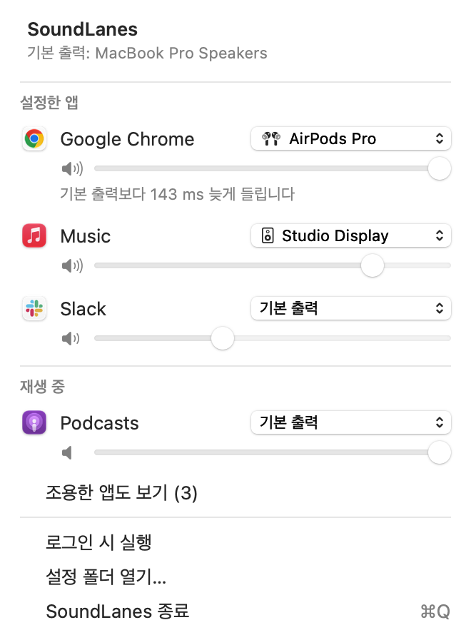

# SoundLanes


Send each app's sound to a different output. Music on the MacBook speakers, a YouTube tab in your AirPods, Slack a bit quieter than everything else.

macOS only has one output for everything. SoundLanes sits in the menu bar and lets you pick a device per app. No audio driver is installed: it uses the Core Audio process taps that came with macOS 14.2, so if SoundLanes quits or crashes, sound goes straight back to where it was.



The interface is in Korean.

## Requirements

- macOS 15 Sequoia or later (built and tested on Apple Silicon)
- Xcode 16 or the Command Line Tools to build it

## Install

There's no prebuilt download yet, so build it:

```sh
git clone https://github.com/soysaucecrab/SoundLanes.git
cd SoundLanes
scripts/bundle-app.sh release
cp -R build/SoundLanes.app /Applications/
open /Applications/SoundLanes.app
```

`bundle-app.sh` signs the app with your Apple Development certificate if you have one, otherwise ad-hoc. With an ad-hoc signature macOS may ask for permission again after every rebuild.

The first time an app is routed, macOS asks whether SoundLanes can record system audio. It needs this to take the app's sound and play it somewhere else. If you route to AirPods or anything else with a microphone, macOS may also ask about the microphone; SoundLanes never reads it.

## Features

- Pick an output device for any app that plays sound, right from the menu bar
- Volume per app, including apps that stay on the default output
- Helper processes are included. Chrome and Electron apps (Slack, Discord, …) make their sound in helpers, and those move with the app. Safari plays through a shared WebKit process and is routed with it
- Follows your devices: take the AirPods out and the app falls back to the default output, put them back in and it moves back. Relaunched apps get their device again
- Apps you've sent to a specific device stay there when you change the system output
- The speaker icon next to each slider moves with the app's level, and a note shows up when the target device is noticeably slower than the default
- Notifications when a route fails or permission is missing
- Open at login
- A command line tool for the same settings

## Usage

Click the speaker icon in the menu bar. Apps that are playing show up in the list, and each has a device menu and a volume slider. Choosing a device takes effect right away; **기본 출력** (default output) puts the app back. Apps you've set stay at the top, and **조용한 앱도 보기** shows the ones that are open but quiet.

Settings live in `~/Library/Application Support/SoundLanes/routes.json`.

### Command line

```sh
swift build
.build/debug/soundlanes devices                       # output devices
.build/debug/soundlanes apps --all                    # apps that use audio
.build/debug/soundlanes add Chrome AirPods            # route Chrome to AirPods
.build/debug/soundlanes add Slack default --volume 0.4
.build/debug/soundlanes list
.build/debug/soundlanes remove Chrome
.build/debug/soundlanes status                        # what the running app is doing
```

`add` and `remove` apply immediately when the app is running. Without the app, `soundlanes run` applies the rules in the foreground (only one of the two can run at a time).

## How it works

```
Chrome ──(process tap, muted while tapped)──▶ private aggregate device { AirPods + tap } ──▶ AirPods
Chrome's normal output ──▶ default output   (silent while the tap is being read)
```

For every routed app, SoundLanes creates a process tap on the app and its helpers, a private aggregate device with the target output and that tap, and an IO callback that copies the tap into the output with the app's volume. The tap only mutes the app while someone is reading it, which is why sound comes back on its own when SoundLanes stops, even after `kill -9`.

## FAQ

### Nothing changes when I pick a device

Check **System Settings → Privacy & Security → Screen & System Audio Recording** and make sure SoundLanes is allowed. The menu also shows a warning when the permission is missing. If SoundLanes isn't listed, reset it and open the app again:

```sh
tccutil reset AudioCapture com.zinu.soundlanes
```

### Video is out of sync in my AirPods

The video player thinks it's playing on the default output and times the picture for that device, but the sound actually goes to the AirPods, which are slower. There's no way to delay someone else's video. If it bothers you, do it the other way around: make the AirPods the default output and send your music app to the speakers.

### Routing Safari also moves another app

Safari and other apps built on WebKit share one audio process, so they move together.

### People on a call hear an echo

Call apps cancel echo based on the device they think they're playing on. Leave Zoom, FaceTime and similar apps on the default output.

### How do I uninstall it?

Quit SoundLanes from its menu and delete it from `/Applications`. To remove its settings and permission too:

```sh
rm -r ~/Library/Application\ Support/SoundLanes
tccutil reset AudioCapture com.zinu.soundlanes
```

## Building

There are no dependencies other than [swift-argument-parser](https://github.com/apple/swift-argument-parser) for the CLI.

```sh
swift build
swift test
scripts/bundle-app.sh debug                                     # build/SoundLanes.app
open -n build/SoundLanes.app --args --demo --capture-menu /tmp/menu.png   # the screenshot above
Tools/RouteCheck/run.sh                                         # routing check with a quiet test tone (app must be running)
```

`Sources/RouteCore` has the Core Audio code and the routing engine, `Sources/SoundLanesApp` the menu bar app, and `Sources/soundlanes` the CLI. The full spec, including what was tested and how, is in [`SPEC.md`](SPEC.md) (in Korean).

If you want something polished and supported, Rogue Amoeba's SoundSource does all of this and more. This is a small personal project and isn't related to it.
